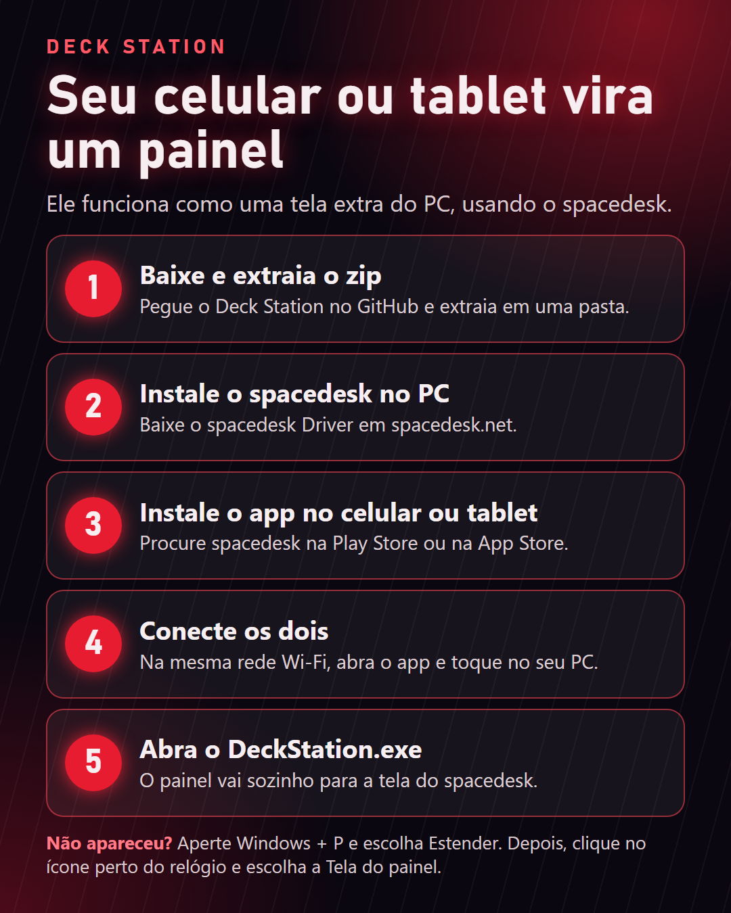
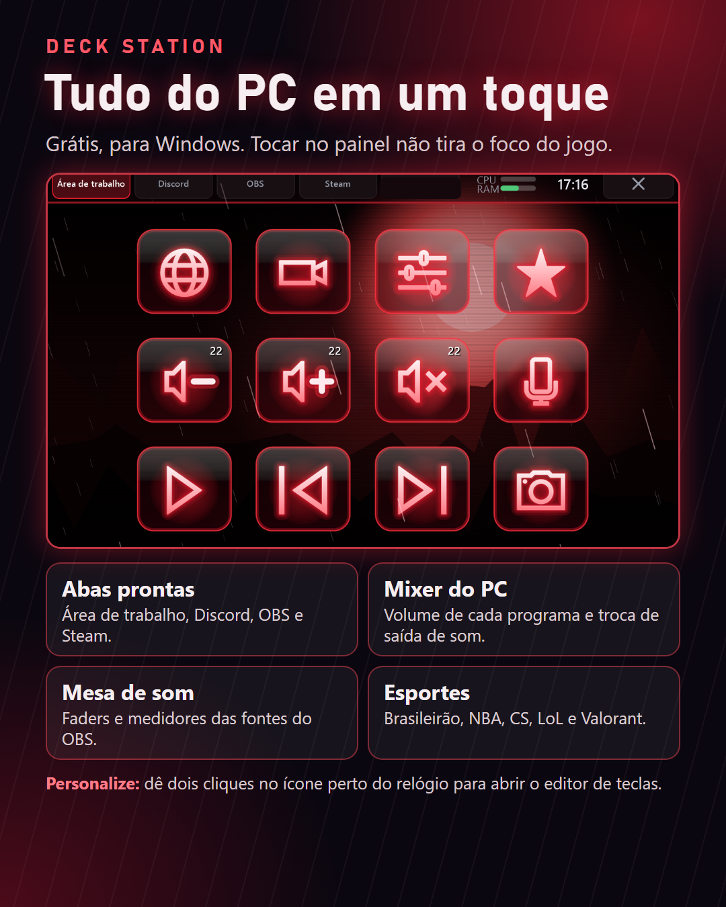

# Deck Station

Transforma um celular ou tablet em um painel de atalhos para o PC, usando o [spacedesk](https://www.spacedesk.net).

## Downloads

Baixe o **Deck-Station-v1.0.zip** na página de **Releases**.

## O que ele faz

Abas de Área de trabalho, Discord, OBS e Steam, mixer do PC, mesa de som do OBS e placares de esportes. Tocar no painel não tira o foco do jogo.

## Compilar

Rode `fonte/compilar.bat` no Windows. Ele usa o compilador C# que já vem com o sistema.

Deck Station não tem ligação com a Elgato ou o spacedesk.

Dados de e-sports: [Liquipedia](https://liquipedia.net) (CC-BY-SA). Placares de futebol e NBA: ESPN.
